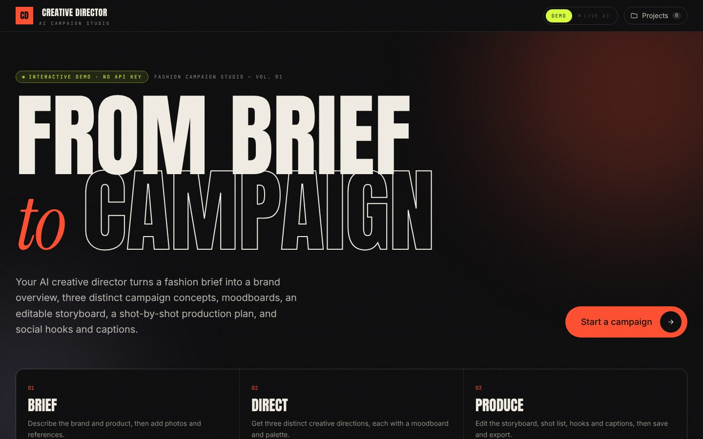
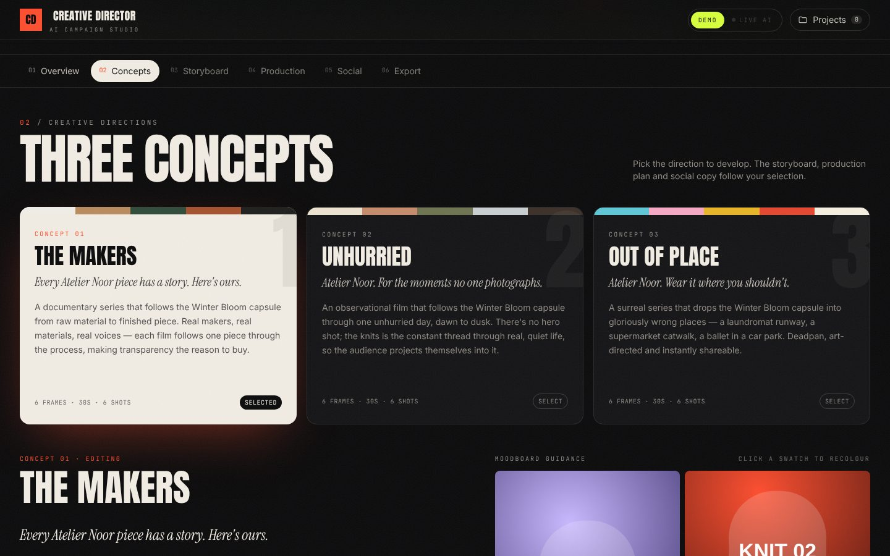
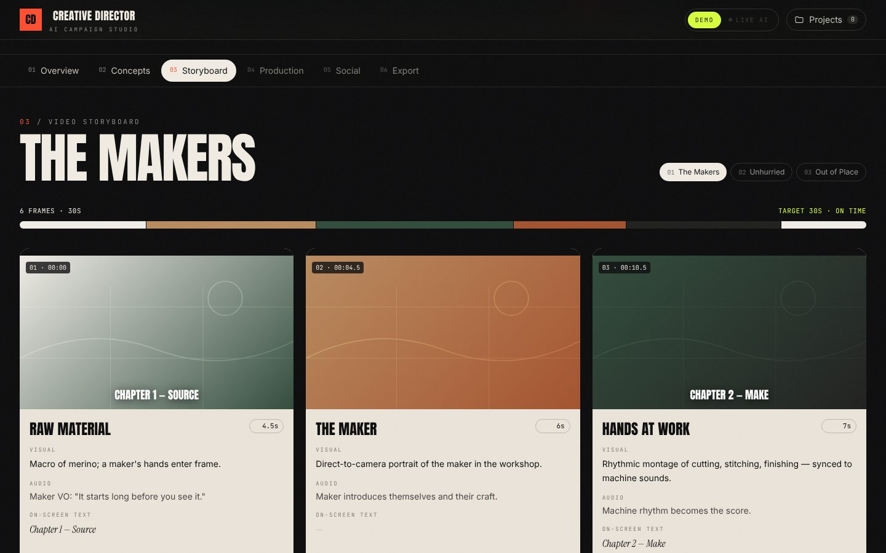

# AI Creative Director

**An interactive fashion-campaign studio.** Enter a brand brief with product photos and reference links, and explore a brand overview, three distinct campaign concepts, moodboard guidance, an editable video storyboard, a shot-by-shot production plan, TikTok and Instagram hooks, and captions. Then save and export.

Built with **Next.js 16 (App Router) · TypeScript · Tailwind CSS 4 · Zod · Vitest**, with an optional server-side **Claude API** integration.



> **No API key needed.** Demo mode is the default and runs entirely without a paid AI service. Its output is clearly labelled as *illustrative demo content*.

---

## The workflow

| Step | What you do |
|---|---|
| **01 Brief** | Enter the brand name and description, product or collection description and campaign goal. Optionally add up to six product photos (with previews and remove buttons), Instagram and TikTok references, product website links, reference videos (YouTube, Instagram Reels, TikTok), platforms, target audience and video duration (15, 30, 45 or 60s). |
| **02 Overview** | A brand summary, positioning, audience insight, tone keywords and three brand pillars. It also shows exactly how the demo read your brief, plus your photos and saved links. |
| **03 Concepts** | Three distinct creative directions (each with a big idea, why it works, visual direction, soundtrack and a moodboard collage). The moodboard combines your photos, an editable palette, keywords, and guidance on lighting, styling, locations and references. |
| **04 Storyboard** | Film-strip frame cards with timecodes and a timeline against your target duration. Edit any text in place; add, insert, reorder or delete frames; mark product shots. Your photos appear in product frames. |
| **05 Production** | One shot per frame: shot type, action, camera/lens, movement, lighting, location, talent and a director's note. Everything is editable. |
| **06 Social** | Editable TikTok and Instagram hooks, a caption for each platform with hashtags, character counts and copy buttons, plus a phone mock-up preview. |
| **07 Export** | Save to the browser, download a Markdown treatment or a JSON project file (which can be imported again), and read the demo's limitations. |





---

## How demo mode works, and what it doesn't do

Demo mode is a **transparent, rule-based engine** (`src/lib/demo/`). It does not use AI.

1. **`analyze.ts`** matches keywords in the brief text. It detects:
   - the category (denim, knitwear, activewear, jewellery and so on)
   - brand signals (sustainable, craft, luxury, playful, minimal, performance, heritage, community, bold)
   - the goal type (launch, awareness, conversion, community, repositioning)
   - a short product phrase.
2. **`archetypes.ts`** holds six creative "lanes": observational, nocturnal/cultural, craft documentary, sensory product, surreal/performative and kinetic. It scores each against the analysis and picks three distinct ones.
3. **`index.ts`** personalises every line with your brand, product, materials, platforms and goal, and scales storyboard frames and timings to your chosen duration.

Output is deterministic for a given brief, so the same brief always gives the same result.

**Honesty rules built into the UI and engine:**
- Every workspace shows an *Illustrative demo* label and banner, and so does the Markdown export.
- The Overview lists the keywords the demo matched ("Rule-based keyword matching, not AI analysis").
- Photos and links are always described as *references (not analysed)*. The engine never claims to have looked at them, and a test enforces this.

### Limitations

| | |
|---|---|
| **Photos** | Kept in browser memory as object URLs. They are never uploaded or analysed, and previews disappear after a page refresh. Only file names are saved. Reopened projects show placeholders until you re-attach the photos in the brief. |
| **Links** | Validated, saved, shown and exported, but never fetched. |
| **Storage** | Projects are kept in `localStorage` in that browser, up to 50 of them. Export JSON to keep a backup or move projects between browsers. |

---

## Path to real AI

The same schema, API route and workspace already support live generation with Claude:

1. Set `ANTHROPIC_API_KEY` on the server. The **Live AI** toggle unlocks and `/api/generate` calls Claude (`claude-opus-5-5` by default) with **structured outputs** that match the campaign schema. The server validates and cleans up the result.
2. Next steps: send product photos to a vision model, fetch reference links on the server and summarise them as extra context, and move projects and photos to cloud storage.

The Claude prompt tells the model that it can't see links or photos and must never claim to have reviewed them.

---

## Quick start

Requires **Node.js 20.9+** (22 recommended).

```bash
npm install
```

```bash
npm run dev
```

Open http://localhost:3000. Demo mode works right away.

### Optional: live Claude generation

```bash
cp .env.example .env.local
```

| Variable | Required | Default | Purpose |
|---|---|---|---|
| `ANTHROPIC_API_KEY` | Live mode only | — | Server-side key. It is never exposed to the browser. |
| `ANTHROPIC_MODEL` | No | `claude-opus-5-5` | Override the model. |
| `LIVE_RATE_LIMIT_PER_HOUR` | No | `10` | Live generations allowed per IP per hour. |

### Scripts

| Command | What it does |
|---|---|
| `npm run dev` | Start the dev server |
| `npm run build` / `npm start` | Production build / serve |
| `npm test` | Run the Vitest suite once |
| `npm run typecheck` | `tsc --noEmit` |
| `npm run lint` | ESLint |

---

## Architecture

```
src/
├─ app/
│  ├─ api/generate/route.ts   # demo + live generation (validation, size limit, rate limit)
│  ├─ api/status/route.ts     # tells the UI whether live mode is configured
│  └─ layout.tsx, page.tsx, globals.css (design tokens, fonts, grain, animations)
├─ components/
│  ├─ Studio.tsx              # orchestrates brief → loading → workspace, photos, saving
│  ├─ Header.tsx, GeneratingState.tsx, ProjectsDrawer.tsx, ui.tsx
│  ├─ brief/                  # Hero, BriefForm, PhotoUploader, LinkListInput
│  └─ workspace/              # Workspace shell + Overview, Concepts, Storyboard,
│                             # Production, Social, Export sections
└─ lib/
   ├─ schema.ts               # Zod schemas: the single source of truth for types
   ├─ demo/                   # analyze.ts, archetypes.ts, index.ts (demo engine)
   ├─ links.ts, photos.ts     # link classification, photo validation and helpers
   ├─ editor.ts               # pure reducer for all editing (frames, shots, hooks, captions)
   ├─ storage.ts              # validated localStorage + useSyncExternalStore bindings
   ├─ export.ts               # Markdown treatment
   ├─ prompt.ts, normalize.ts # Claude prompt, output schema, post-validation
   └─ server/                 # claude.ts (server-only), rate-limit.ts, http.ts
```

**Key decisions**
- **Zod at every boundary.** The request body, model output, saved projects and imported files are all validated, and types are inferred from the schemas.
- **Demo and live share one contract.** Both return the same `Campaign` shape through the same route, so the UI doesn't care which one produced it.
- **Pure editing reducer.** Every storyboard, shot, hook and caption operation is a unit-tested reducer action.
- **Accessible by default.** Fields have real labels, validation errors are announced with focus moved to the first error, controls are keyboard-friendly, and reduced-motion preferences are respected.
- **Security.** The API key is server-only (`server-only` import), the request body is capped at 16 KB, live calls are rate-limited per IP, the user's brief can't override the prompt instructions, external links open with `rel="noopener noreferrer"`, and baseline security headers are set.

---

## Testing

```bash
npm test
```

There are **111 tests across 13 files**. They cover:
- schemas and link rules
- the demo engine (analysis, archetype selection, timing that adds up exactly, hooks and captions, and honesty about photos and links)
- photo validation, the editor reducer, storage and export
- Claude normalisation and error mapping against a fake SDK client
- the API route
- a jsdom UI test of the whole workflow: validation → photos and links → create → every workspace section → edit → save → reopen after a reload, plus the live-mode error fallback.

The tests never call the real Claude API. CI (`.github/workflows/ci.yml`) runs lint, typecheck, tests and a production build.

---

## Deploying to Vercel

1. Import the repository at [vercel.com/new](https://vercel.com/new). Next.js is detected automatically.
2. **Optional:** add `ANTHROPIC_API_KEY` under **Settings → Environment Variables** to enable Live AI. Without it, the site runs in demo mode only, which is safe to share publicly.
3. Deploy. Pull requests get their own **Preview deployment**, so you can review changes before merging to the production branch.

`/api/generate` sets `maxDuration = 120` seconds, which is within Vercel's default limits.
