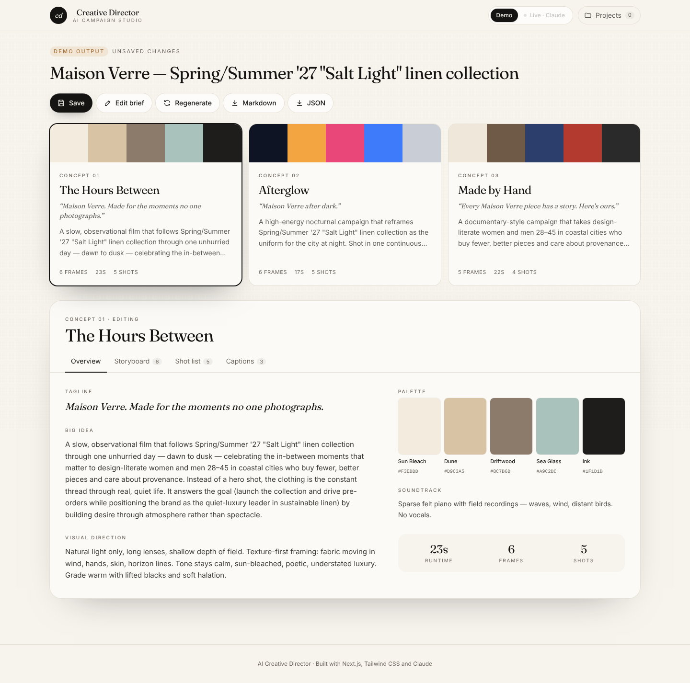
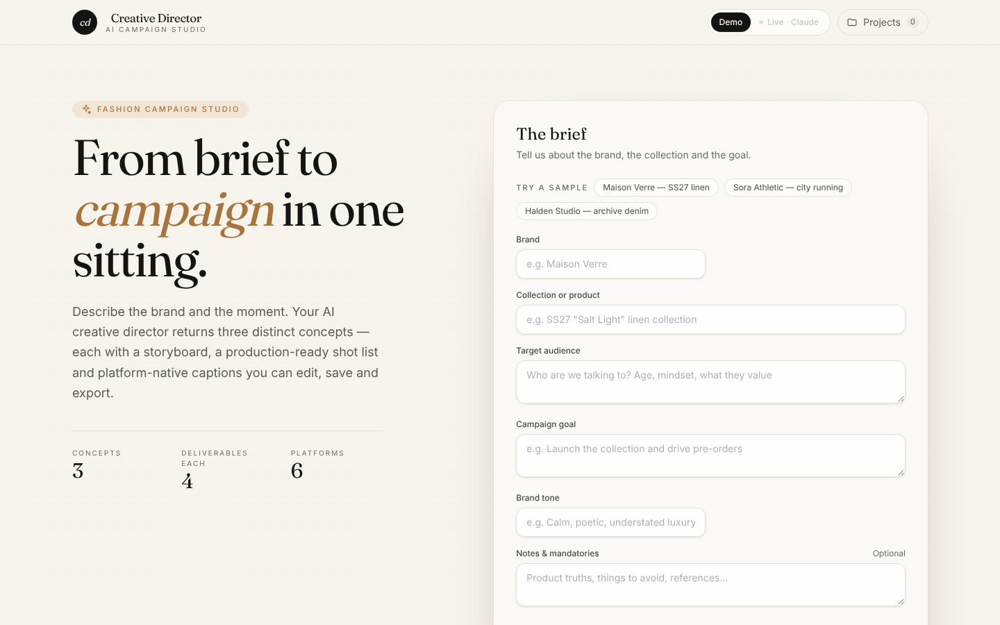
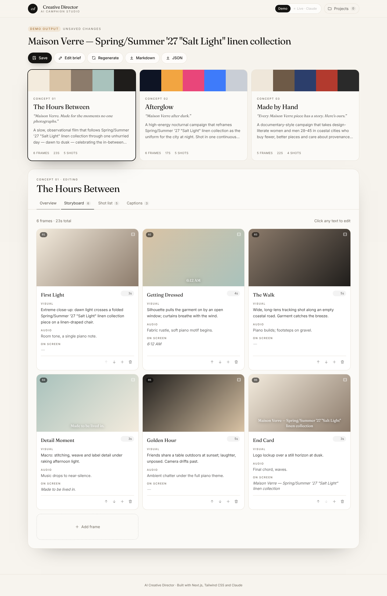

# AI Creative Director

**Turn a fashion brand brief into three campaign concepts in under a minute.** Each concept includes a big idea, a visual direction and colour palette, an editable video storyboard, a production-ready shot list, and captions written for each social platform.

Built with **Next.js 16 (App Router) · TypeScript · Tailwind CSS 4 · Claude API · Zod · Vitest**.



> **Try it without an API key.** Demo mode is on by default and works fully offline: pick a sample brief, click **Generate campaign**, then edit, save and export.

---

## Features

| | |
|---|---|
| **Brief → 3 concepts** | Structured brief (brand, collection, audience, goal, tone, platforms, notes) with validation and three one-click sample briefs. |
| **Two generation modes** | **Demo:** a local, brief-aware generator that needs no key. **Live:** Claude generates the campaign on the server using structured outputs. |
| **Editable storyboards** | Frame cards with visual, audio, on-screen text and duration. Edit any text in place, reorder, insert and delete frames. Runtime totals update as you edit. |
| **Shot lists** | A production table (shot type, description, camera/lens, location, talent, seconds) with the same editing controls. |
| **Social captions** | One caption per platform, with character counts, editable hashtags, copy to clipboard, and add or remove per platform. |
| **Project saving** | Save to browser storage, reopen, rename, delete, and import projects. Changes in other tabs stay in sync, and you get a warning before leaving with unsaved changes. |
| **Export** | A client-ready **Markdown** treatment, or **JSON** that you can import again. |
| **Error handling** | Validation on both client and server, typed error codes, friendly messages, a one-click demo fallback when live mode fails, and an error-tolerant storage layer. |
| **Polish** | Editorial design, responsive layout down to 360px, keyboard and screen-reader labels, and support for reduced motion. |

<details>
<summary>More screenshots</summary>




</details>

---

## Quick start

Requires **Node.js 20.9+** (22 recommended).

```bash
npm install
```

```bash
npm run dev
```

Open http://localhost:3000. Demo mode works right away.

### Enable live Claude generation

```bash
cp .env.example .env.local
```

Set `ANTHROPIC_API_KEY` in `.env.local` ([get a key](https://console.anthropic.com/)), then restart `npm run dev`. The **Live · Claude** toggle in the header turns on automatically.

| Variable | Required | Default | Purpose |
|---|---|---|---|
| `ANTHROPIC_API_KEY` | For live mode | — | Server-side Claude API key. Never exposed to the browser. |
| `ANTHROPIC_MODEL` | No | `claude-opus-5-5` | Override the model. |
| `LIVE_RATE_LIMIT_PER_HOUR` | No | `10` | Live generations allowed per IP per hour. |

### Scripts

| Command | What it does |
|---|---|
| `npm run dev` | Start the dev server |
| `npm run build` / `npm start` | Production build / serve |
| `npm test` | Run the Vitest suite once |
| `npm run test:watch` | Run tests in watch mode |
| `npm run typecheck` | `tsc --noEmit` |
| `npm run lint` | ESLint (Next.js config) |

---

## Architecture

```
Browser (client components)                    Server (Next.js route handlers)
┌──────────────────────────────┐               ┌──────────────────────────────────────┐
│ Studio ── BriefForm          │  POST          │ /api/generate                        │
│   │       ConceptCards       │  {brief,mode}  │  ├ size limit + JSON parse           │
│   │       ConceptWorkspace   │ ─────────────▶ │  ├ Zod validation (BriefSchema)      │
│   │        ├ Storyboard      │                │  ├ mode=demo → generateDemoCampaign  │
│   │        ├ Shot list       │                │  └ mode=live → rate limit →          │
│   │        └ Captions        │ ◀───────────── │       generateWithClaude (server-only)│
│   ├ editorReducer (pure)     │  {campaign} or │         ├ Claude structured outputs   │
│   ├ storage (localStorage)   │  {error:{code}}│         ├ normalize + validate        │
│   └ export (Markdown / JSON) │                │         └ typed error mapping         │
└──────────────────────────────┘               │ /api/status → { liveAvailable, model }│
                                               └──────────────────────────────────────┘
```

```
src/
├─ app/
│  ├─ api/generate/route.ts   # generation endpoint (demo + live)
│  ├─ api/status/route.ts     # tells the UI whether live mode is configured
│  ├─ layout.tsx, page.tsx, globals.css
├─ components/                # Studio (state orchestration), BriefForm, Header,
│                             # ConceptCards, ConceptWorkspace, ProjectsDrawer, ui
├─ lib/
│  ├─ schema.ts               # Zod schemas = single source of truth for types
│  ├─ demo.ts                 # deterministic demo generator
│  ├─ prompt.ts               # system prompt, user prompt, Claude output schema
│  ├─ normalize.ts            # model output → validated Campaign
│  ├─ editor.ts               # pure reducer for all editing operations
│  ├─ storage.ts              # validated localStorage persistence
│  ├─ export.ts, api-client.ts, samples.ts, id.ts
│  └─ server/
│     ├─ claude.ts            # Anthropic SDK integration (imports "server-only")
│     ├─ rate-limit.ts        # per-IP limiter for the paid endpoint
│     └─ http.ts
└─ test/                      # setup + shared fixtures
```

### Key decisions

- **Zod at every boundary.** The HTTP body, Claude's output and stored projects are all validated against the same schemas in `lib/schema.ts`. TypeScript types are inferred from those schemas, so types and runtime checks cannot drift apart.
- **Structured outputs instead of parsing prose.** `generateWithClaude` calls `client.beta.messages.stream()` with `output_config.format` built from a Zod schema (`betaZodOutputFormat`). The response is guaranteed to be JSON matching that schema. It streams to avoid HTTP timeouts on long generations, then reads `finalMessage().parsed_output`.
- **Post-validation for what JSON Schema can't express.** `normalize.ts` makes sure there are exactly three concepts, fixes hex colours, clamps durations, normalises hashtags, removes captions for platforms that weren't requested, and assigns ids.
- **Safe failure modes.** `stop_reason` is checked for `refusal` and `max_tokens`. SDK errors are mapped by type (`AuthenticationError`, `RateLimitError`, `APIConnectionError`, …) to stable `ApiErrorCode`s with friendly messages, and raw upstream messages never reach the client. The server-side refusal fallback (`fallbacks: "default"`) is enabled for models that support it.
- **Prompt-injection hygiene.** The brief is wrapped in tags, angle brackets are removed, and the system prompt tells Claude to treat the brief as data.
- **Demo mode is a real code path.** It goes through the same API route and schema as live mode, and it is deterministic, which makes it a stable test fixture.
- **Editing is a pure reducer.** Every storyboard, shot and caption operation lives in `editorReducer`, so each one is unit-tested without a DOM.
- **Saving without a database.** Projects live in `localStorage`, behind a small, validated, injectable storage interface, so there is nothing to provision for a demo deployment. Moving to a server store (Postgres, Vercel KV, …) means replacing `lib/storage.ts`.

### Security

- `ANTHROPIC_API_KEY` is read only in `lib/server/claude.ts`, which imports `server-only`, so the build fails if it is ever bundled for the client. `/api/status` reports only whether a key exists.
- The request body is limited to 16 KB, and every brief field has a length cap.
- The live endpoint is rate-limited per IP (10 per hour by default). The limiter keeps its counts in memory on each instance. For multi-region production traffic, replace it with Upstash or Vercel KV.
- Baseline security headers (`X-Frame-Options`, `X-Content-Type-Options`, `Referrer-Policy`, `Permissions-Policy`) are set in `next.config.ts`. The `X-Powered-By` header is turned off.

---

## Testing

```bash
npm test
```

There are **71 tests across 11 files**:

| Area | File(s) |
|---|---|
| Schemas & validation | `lib/schema.test.ts` |
| Demo generator (shape, personalisation, determinism, unique ids) | `lib/demo.test.ts` |
| Claude output normalisation | `lib/normalize.test.ts` |
| Prompt construction & injection hygiene | `lib/prompt.test.ts` |
| Editor reducer (update, insert, move, delete) | `lib/editor.test.ts` |
| Storage (corruption, quota, caps, import) | `lib/storage.test.ts` |
| Markdown export | `lib/export.test.ts` |
| Claude integration with a fake SDK client (params, refusals, truncation, error mapping) | `lib/server/claude.test.ts` |
| Rate limiter | `lib/server/rate-limit.test.ts` |
| API route (demo, validation, 413, 503, live, typed errors, 429) | `app/api/generate/route.test.ts` |
| UI integration in jsdom (validate → generate → edit → save → reopen, error fallback) | `components/Studio.test.tsx` |

The test suite never calls the real Claude API. CI (`.github/workflows/ci.yml`) runs lint, typecheck, tests and a production build on every PR.

---

## Deploying to Vercel

1. **Push** the repository to GitHub.
2. In Vercel, go to **[Add New → Project](https://vercel.com/new)** and import the repo. The Next.js framework is detected automatically, and no build settings need to change.
3. **Optional, for live mode:** under **Settings → Environment Variables**, add `ANTHROPIC_API_KEY`. You can also add `ANTHROPIC_MODEL` and `LIVE_RATE_LIMIT_PER_HOUR`. Apply them to Production and, if you like, Preview.
4. **Deploy.** Without a key, the deployment runs in demo-only mode and the Live toggle is disabled with a tooltip. That makes it safe to share a public recruiter link.
5. After you add or change environment variables, **redeploy** so they take effect.

Notes:
- `/api/generate` sets `maxDuration = 120` seconds. That is within the default Fluid Compute limits on all Vercel plans. If you have turned Fluid Compute off on the Hobby plan, lower it to 60.
- Prefer the CLI?

  ```bash
  npm i -g vercel
  ```

  ```bash
  vercel
  ```

  ```bash
  vercel env add ANTHROPIC_API_KEY
  ```

  ```bash
  vercel --prod
  ```

---

## Roadmap ideas

- Regenerate a single concept or section, and stream partial results into the UI
- Image moodboards for each storyboard frame
- Cloud project storage with authentication, plus shareable read-only links
- PDF treatment export
