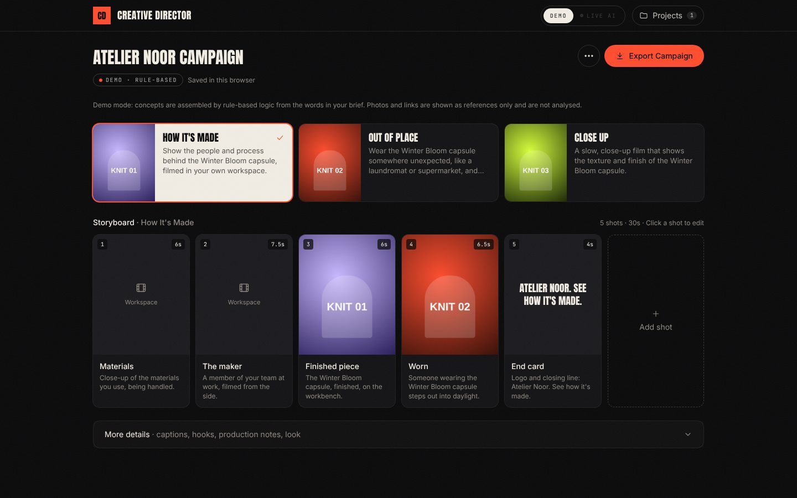
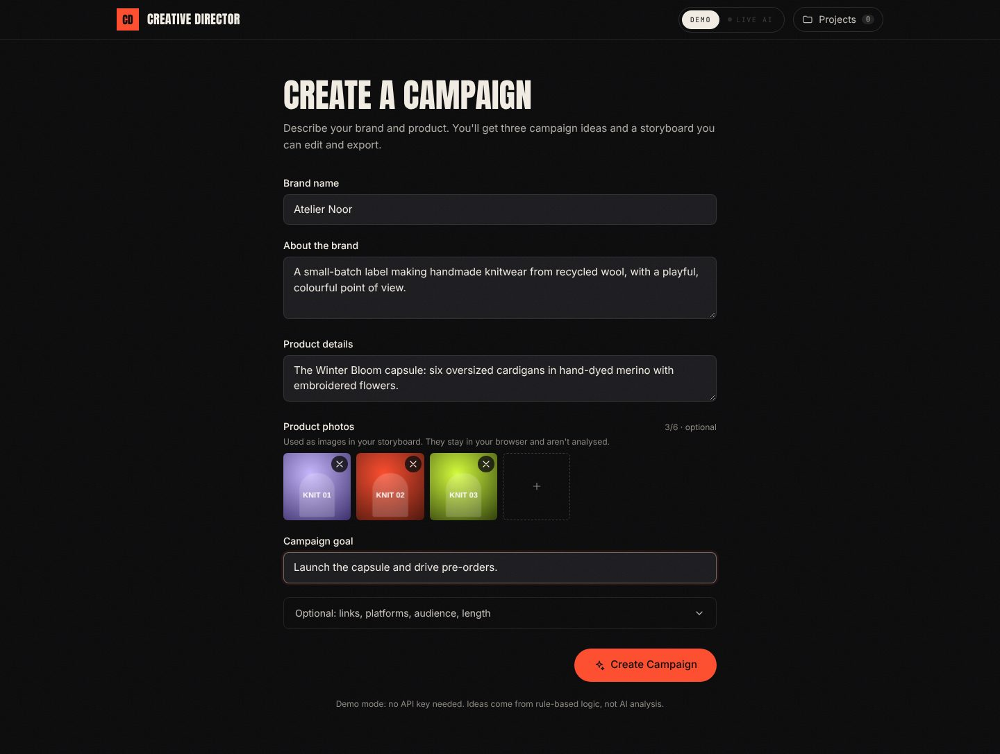
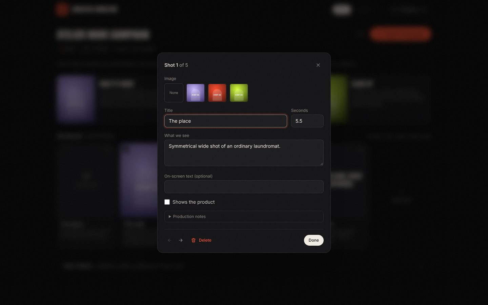

# AI Creative Director

**A simple creative tool for fashion campaigns.** Describe a brand and product, add photos if you have them, and get three campaign ideas with a visual storyboard you can edit and export, all on one page.

Built with **Next.js 16 · TypeScript · Tailwind CSS 4 · Zod · Vitest**, with an optional server-side **Claude API** integration.



> **No API key needed.** Demo mode is the default. It uses clearly labelled, rule-based logic (not AI analysis), so anyone can try the full workflow.

---

## How it works

Two screens and three clicks from brief to export:

1. **Brief.** A single input page with brand name, about the brand, product details, product photos (optional, up to 6) and campaign goal. Links, platforms, audience and video length sit in one optional, collapsed section. **Click: Create Campaign.**
2. **Results.** One page holds the whole campaign:
   - **Three concept cards** at the top, each with a title, a one-sentence idea and a preview image from your photos. The first concept is selected automatically. **Click another concept** and the storyboard and all details update in place.
   - **A storyboard of 4–6 shots.** Each shot shows a product photo (where the shot features the product), a short description and its duration. Click a shot to edit it in a compact dialog: image, title, description, on-screen text, seconds, reorder and delete.
   - **More details**, collapsed: hooks and captions, production notes (camera, setting, direction), look and sound, and your brief with saved links.
   - **Export Campaign** is the one primary action. It downloads a Markdown treatment of the chosen concept, with the other two summarised. **Click: Export.**
   - Edit brief, Save, Regenerate, Download project file and New campaign live in a small **⋯** menu. Projects also save automatically in the browser.




---

## Demo mode: what it does and doesn't do

The demo engine (`src/lib/demo/`) is **transparent keyword matching**, not AI:

- `analyze.ts` looks for words in the brief that indicate category, style signals (for example sustainable, handmade, playful, minimal, performance) and goal type. It takes a short product phrase straight from the user's own description.
- `archetypes.ts` holds seven *filming formats*: Product Portrait, In Real Life, Close Up, How It's Made, After Dark, In Motion and Out of Place. It scores them against the brief and picks three. *How It's Made* is only offered when the brief itself mentions craft, sustainability or heritage.
- `index.ts` fills in the brand and product names, fits the shots to the chosen video length, and writes hooks and captions for each platform.

**Guardrails**

- Copy refers only to what the user typed plus generic production direction. It never invents materials, processes, availability or backstories, and a test enforces this.
- Results are labelled "Demo · rule-based", with a one-line explanation. The brief notes list which words were matched.
- Photos and links are always described as references that were *not analysed* or *not opened*.

### Limitations

| | |
|---|---|
| **Photos** | Kept in browser memory only. They are never uploaded or analysed, and previews disappear after a refresh. File names are saved, and reopened projects show placeholders until you re-attach the photos via *Edit brief*. |
| **Links** | Saved, shown and exported, but never fetched. |
| **Storage** | Projects autosave to this browser's `localStorage` (up to 50). Use *Download project file* to back up or move a project. |

---

## Path to real AI

Set `ANTHROPIC_API_KEY` on the server and the **Live AI** toggle unlocks. `/api/generate` then calls Claude (`claude-opus-5-5` by default) with structured outputs that match the same campaign schema, so the UI stays the same. The prompt asks Claude to use only facts from the brief and never to claim it has seen links or photos.

Next steps: send product photos to a vision model, summarise reference links on the server, and add cloud storage with accounts.

---

## Quick start

Requires **Node.js 20.9+** (22 recommended).

```bash
npm install
```

```bash
npm run dev
```

Open http://localhost:3000.

Optional live mode:

```bash
cp .env.example .env.local
```

| Variable | Required | Default | Purpose |
|---|---|---|---|
| `ANTHROPIC_API_KEY` | Live mode only | — | Server-side key, never sent to the browser |
| `ANTHROPIC_MODEL` | No | `claude-opus-5-5` | Model override |
| `LIVE_RATE_LIMIT_PER_HOUR` | No | `10` | Live generations per IP per hour |

| Command | What it does |
|---|---|
| `npm run dev` | Dev server |
| `npm run build` / `npm start` | Production build / serve |
| `npm test` | Vitest suite |
| `npm run typecheck` / `npm run lint` | Type check / ESLint |

---

## Architecture

```
src/
├─ app/api/generate, app/api/status   # demo + live generation; live-mode status
├─ components/
│  ├─ Studio.tsx                      # brief → results, photos, autosave, projects
│  ├─ brief/                          # BriefForm, PhotoUploader, LinkListInput
│  └─ results/                        # Results, ConceptPicker, Storyboard,
│                                     # ShotEditor, MoreDetails, ActionsMenu
└─ lib/
   ├─ schema.ts                       # Zod schemas (single source of truth)
   ├─ demo/                           # rule-based demo engine
   ├─ editor.ts                       # pure reducer for all edits
   ├─ photos.ts, links.ts             # validation, shot↔photo assignment, link labels
   ├─ storage.ts, export.ts           # validated localStorage, Markdown export
   └─ prompt.ts, normalize.ts, server/  # Claude integration (server-only)
```

**Key decisions**

- **One shot list per concept.** Each shot is both a storyboard frame and a production note, so choosing a concept updates the storyboard, production notes and social copy together, and they can never drift apart.
- **Zod at every boundary.** The request body, model output, saved projects and imported files are all validated against the schemas.
- **Accessible.** Fields have real labels, focus moves to the first invalid field, the concept picker is a radio group, the shot editor is a modal dialog that closes with Escape, and reduced-motion preferences are respected.
- **Secure.** The API key is server-only, request bodies are size-capped, live calls are rate-limited, the brief can't override the prompt instructions, and external links open with `rel="noopener noreferrer"`.

---

## Testing

```bash
npm test
```

There are **108 tests across 13 files**. They cover:

- schemas and link handling
- the demo engine (format selection, 4–6 shots that add up exactly to the video length, no invented claims, honest wording about photos and links)
- photo assignment, the editor reducer, storage and export
- Claude normalisation and error mapping (against a fake SDK client)
- the API route
- jsdom UI tests:
  - brief → campaign → compare concepts → export in **three clicks**
  - inline shot editing with autosave
  - the More details section and the secondary menu
  - reopening a project after a reload
  - the live-mode error fallback

CI runs lint, typecheck, tests and a production build on every pull request.

---

## Deploying to Vercel

Import the repository at [vercel.com/new](https://vercel.com/new); Next.js is detected automatically. Optionally add `ANTHROPIC_API_KEY` under **Settings → Environment Variables**. Without it the site runs in demo mode only, which is safe to share publicly. Every pull request gets its own Preview deployment, so you can review changes before merging.
